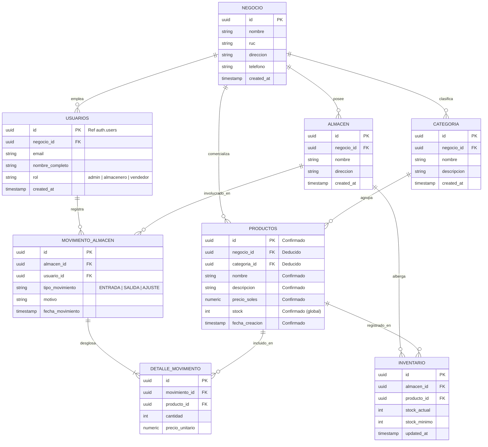

# GUÍA TÉCNICA Y DEFENSA DE PROYECTO: SISTEMA DE ALMACÉN E INVENTARIO

> **Documento para preparación de diapositivas (PPT) y defensa universitaria.**  
> **Stack:** Next.js 16 (App Router + Server Actions) + Supabase (PostgreSQL + Auth + RLS) + Tailwind CSS v4 + TypeScript.

---

## 1. TIPO DE PROYECTO

### 1.1 ¿Qué es?
Es una **aplicación web empresarial para la gestión integral de almacén e inventario (WMS / SGA Ligero)**. Permite centralizar el catálogo de productos, controlar las existencias en stock, auditar movimientos de entrada/salida y restringir operaciones según el perfil del colaborador.

### 1.2 Problema que resuelve
- **Pérdida de trazabilidad:** Elimina el uso de hojas de cálculo propensas a errores humanos o desactualizaciones.
- **Quiebres de stock o sobre-stock:** Proporciona visibilidad en tiempo real de las existencias para reposición oportuna.
- **Falta de segregación de funciones:** Evita que personal no autorizado modifique precios, elimine registros o altere el inventario físico sin supervisión.
- **Dispersión de información:** Consolida sedes o almacenes bajo una misma estructura de datos relacional.

### 1.3 Roles y Usuarios
1. **Administrador (`admin`):**
   - Acceso total al sistema.
   - Creación, modificación y eliminación del catálogo de productos y precios.
   - Gestión de usuarios y supervisión de reportes generales.
2. **Almacenero (`almacenero`):**
   - Registro de entradas (recepción de proveedores), salidas por merma/traslado y transferencias entre almacenes.
   - Consulta de stock físico y ejecución de inventarios rotativos.
3. **Vendedor (`vendedor`):**
   - Consulta de productos, precios unitarios en soles (`S/`) y disponibilidad de stock en tiempo real.
   - Emisión de solicitudes de salida o despacho por ventas.

### 1.4 Alcance y Arquitectura
- **Modelo Cliente/Servidor Moderno (App Router de Next.js):**
  - **Server Components (RSC):** Las páginas (`/admin`, `/login`) se renderizan en el servidor, consultando la base de datos de forma directa y segura sin exponer credenciales en el cliente.
  - **Client Components ('use client'):** Utilizados exclusivamente donde se requiere interactividad del navegador (ej. `BotonEliminar.tsx` para cuadros de confirmación antes de mutar datos).
  - **Server Actions ('use server'):** Mutaciones (creación, edición, eliminación de productos y login) ejecutadas mediante funciones asíncronas en el servidor, eliminando la necesidad de crear endpoints API REST manuales.
  - **Backend as a Service (BaaS):** Supabase provee la capa de persistencia PostgreSQL, motor de autenticación seguro y control de acceso a nivel de fila (RLS).

---

## 2. MODELO ENTIDAD-RELACIÓN

### 2.1 Clasificación de Evidencia
- **CONFIRMADO EN CÓDIGO:**
  - Tabla `productos` con columnas: `id`, `nombre`, `descripcion`, `precio_soles`, `stock`, `fecha_creacion`.
  - Roles en estructura del proyecto: `admin`, `almacenero`, `vendedor`.
  - Autenticación: Supabase Auth (`auth.users`) integrada mediante `iniciarSesion`.
- **DEDUCIDO (Basado en el esquema de 8 tablas de Supabase para este dominio):**
  - Tablas: `negocio`, `usuarios`, `categoria`, `almacen`, `inventario`, `movimiento_almacen`, `detalle_movimiento`.
  - Foráneas (FK) y cardinalidades lógicas para soportar operación multi-almacén y multi-usuario.

### 2.2 Cardinalidades y Relaciones
- Un **NEGOCIO** tiene muchos **USUARIOS** (1:N)
- Un **NEGOCIO** administra muchas **CATEGORIAS** (1:N)
- Un **NEGOCIO** posee muchos **ALMACENES** (1:N)
- Un **NEGOCIO** registra muchos **PRODUCTOS** (1:N)
- Una **CATEGORIA** agrupa muchos **PRODUCTOS** (1:N)
- Un **ALMACEN** y un **PRODUCTO** se vinculan en **INVENTARIO** (N:M resuelta con tabla intermedia con stock por almacén)
- Un **USUARIO** genera muchos **MOVIMIENTOS DE ALMACÉN** (1:N)
- Un **ALMACEN** es origen/destino de muchos **MOVIMIENTOS DE ALMACÉN** (1:N)
- Un **MOVIMIENTO DE ALMACEN** contiene muchos **DETALLES DE MOVIMIENTO** (1:N)
- Un **PRODUCTO** puede figurar en muchos **DETALLES DE MOVIMIENTO** (1:N)

### 2.3 Diagrama Mermaid (`erDiagram`)
*(Compatible para copiar y pegar directamente en [mermaid.live](https://mermaid.live))*



---

## 3. MODELO LÓGICO DE LA BASE DE DATOS

### 3.1 Diccionario de Datos

#### 1. Tabla: `negocio` *(Deducido)*
Representa la entidad empresarial u organización.
| Columna | Tipo de Dato | Clave | Restricciones | Descripción |
| :--- | :--- | :--- | :--- | :--- |
| `id` | `UUID` | **PK** | `DEFAULT gen_random_uuid()` | Identificador único del negocio |
| `nombre` | `VARCHAR(150)` | | `NOT NULL` | Razón social o nombre comercial |
| `ruc` | `VARCHAR(20)` | | `UNIQUE, NOT NULL` | Registro tributario |
| `direccion` | `TEXT` | | | Dirección fiscal o principal |
| `telefono` | `VARCHAR(30)` | | | Teléfono de contacto |
| `created_at` | `TIMESTAMPTZ` | | `DEFAULT NOW()` | Fecha y hora de creación |

#### 2. Tabla: `usuarios` *(Deducido / Confirmado por Auth)*
Perfiles de usuarios del sistema asociados a cuentas de Supabase Auth.
| Columna | Tipo de Dato | Clave | Restricciones | Descripción |
| :--- | :--- | :--- | :--- | :--- |
| `id` | `UUID` | **PK, FK** | `REFERENCES auth.users(id) ON DELETE CASCADE` | ID de usuario de Supabase Auth |
| `negocio_id` | `UUID` | **FK** | `REFERENCES negocio(id) ON DELETE CASCADE` | Empresa a la que pertenece |
| `email` | `VARCHAR(255)` | | `NOT NULL, UNIQUE` | Correo electrónico institucional |
| `nombre_completo`| `VARCHAR(150)` | | `NOT NULL` | Nombres y apellidos |
| `rol` | `VARCHAR(30)` | | `CHECK (rol IN ('admin','almacenero','vendedor'))` | Rol en el sistema |
| `created_at` | `TIMESTAMPTZ` | | `DEFAULT NOW()` | Fecha de registro |

#### 3. Tabla: `categoria` *(Deducido)*
Clasificación de familias de productos.
| Columna | Tipo de Dato | Clave | Restricciones | Descripción |
| :--- | :--- | :--- | :--- | :--- |
| `id` | `UUID` | **PK** | `DEFAULT gen_random_uuid()` | Identificador de categoría |
| `negocio_id` | `UUID` | **FK** | `REFERENCES negocio(id) ON DELETE CASCADE` | Negocio propietario |
| `nombre` | `VARCHAR(100)` | | `NOT NULL` | Nombre (ej. Bebidas, Repuestos) |
| `descripcion` | `TEXT` | | | Detalles de la categoría |
| `created_at` | `TIMESTAMPTZ` | | `DEFAULT NOW()` | Fecha de alta |

#### 4. Tabla: `almacen` *(Deducido)*
Ubicaciones físicas de depósito o distribución.
| Columna | Tipo de Dato | Clave | Restricciones | Descripción |
| :--- | :--- | :--- | :--- | :--- |
| `id` | `UUID` | **PK** | `DEFAULT gen_random_uuid()` | Identificador de almacén |
| `negocio_id` | `UUID` | **FK** | `REFERENCES negocio(id) ON DELETE CASCADE` | Negocio propietario |
| `nombre` | `VARCHAR(100)` | | `NOT NULL` | Nombre (ej. Almacén Central) |
| `direccion` | `TEXT` | | | Ubicación física |
| `created_at` | `TIMESTAMPTZ` | | `DEFAULT NOW()` | Fecha de registro |

#### 5. Tabla: `productos` *(Confirmado en código + Deducido)*
Catálogo maestro de artículos para venta o inventario.
| Columna | Tipo de Dato | Clave | Restricciones | Estado |
| :--- | :--- | :--- | :--- | :--- |
| `id` | `UUID` | **PK** | `DEFAULT gen_random_uuid()` | **CONFIRMADO** |
| `negocio_id` | `UUID` | **FK** | `REFERENCES negocio(id) ON DELETE CASCADE` | Deducido |
| `categoria_id` | `UUID` | **FK** | `REFERENCES categoria(id) ON DELETE SET NULL` | Deducido |
| `nombre` | `VARCHAR(200)` | | `NOT NULL` | **CONFIRMADO** |
| `descripcion` | `TEXT` | | | **CONFIRMADO** |
| `precio_soles` | `NUMERIC(10,2)`| | `NOT NULL, CHECK (precio_soles >= 0)` | **CONFIRMADO** |
| `stock` | `INTEGER` | | `NOT NULL, DEFAULT 0, CHECK (stock >= 0)` | **CONFIRMADO** |
| `fecha_creacion`| `TIMESTAMPTZ` | | `DEFAULT NOW()` | **CONFIRMADO** |

#### 6. Tabla: `inventario` *(Deducido)*
Existencias físicas desglosadas por cada almacén.
| Columna | Tipo de Dato | Clave | Restricciones | Descripción |
| :--- | :--- | :--- | :--- | :--- |
| `id` | `UUID` | **PK** | `DEFAULT gen_random_uuid()` | Identificador de inventario |
| `almacen_id` | `UUID` | **FK** | `REFERENCES almacen(id) ON DELETE CASCADE` | Almacén físico |
| `producto_id` | `UUID` | **FK** | `REFERENCES productos(id) ON DELETE CASCADE` | Producto almacenado |
| `stock_actual` | `INTEGER` | | `NOT NULL, DEFAULT 0, CHECK (stock_actual >= 0)` | Cantidad física disponible |
| `stock_minimo` | `INTEGER` | | `DEFAULT 5` | Umbral para alerta de reabastecimiento |
| `updated_at` | `TIMESTAMPTZ` | | `DEFAULT NOW()` | Última actualización de stock |

*Restricción:* `UNIQUE(almacen_id, producto_id)` para evitar registros duplicados del mismo producto en el mismo almacén.

#### 7. Tabla: `movimiento_almacen` *(Deducido)*
Cabecera documental de operaciones de entrada, salida o ajuste.
| Columna | Tipo de Dato | Clave | Restricciones | Descripción |
| :--- | :--- | :--- | :--- | :--- |
| `id` | `UUID` | **PK** | `DEFAULT gen_random_uuid()` | Identificador del movimiento |
| `almacen_id` | `UUID` | **FK** | `REFERENCES almacen(id) ON DELETE RESTRICT` | Almacén afectado |
| `usuario_id` | `UUID` | **FK** | `REFERENCES usuarios(id) ON DELETE RESTRICT` | Responsable del movimiento |
| `tipo_movimiento`| `VARCHAR(20)`| | `CHECK (tipo_movimiento IN ('ENTRADA','SALIDA','AJUSTE'))` | Tipo de operación |
| `motivo` | `TEXT` | | | Glosa o justificación |
| `fecha_movimiento`| `TIMESTAMPTZ`| | `DEFAULT NOW()` | Fecha y hora de transacción |

#### 8. Tabla: `detalle_movimiento` *(Deducido)*
Líneas de productos asociadas a un movimiento de almacén.
| Columna | Tipo de Dato | Clave | Restricciones | Descripción |
| :--- | :--- | :--- | :--- | :--- |
| `id` | `UUID` | **PK** | `DEFAULT gen_random_uuid()` | Identificador del ítem |
| `movimiento_id` | `UUID` | **FK** | `REFERENCES movimiento_almacen(id) ON DELETE CASCADE` | Movimiento cabecera |
| `producto_id` | `UUID` | **FK** | `REFERENCES productos(id) ON DELETE RESTRICT` | Producto transaccionado |
| `cantidad` | `INTEGER` | | `NOT NULL, CHECK (cantidad > 0)` | Unidades afectadas |
| `precio_unitario`| `NUMERIC(10,2)`| | `CHECK (precio_unitario >= 0)` | Costo o precio pactado |

---

### 3.2 Tabla Resumen de Relaciones (Foreign Keys)

| # | Tabla Origen | Columna FK | Tabla Destino | Columna PK | Cardinalidad | Comportamiento Delete |
| :- | :--- | :--- | :--- | :--- | :---: | :--- |
| 1 | `usuarios` | `negocio_id` | `negocio` | `id` | N:1 | `CASCADE` |
| 2 | `usuarios` | `id` | `auth.users` | `id` | 1:1 | `CASCADE` |
| 3 | `categoria` | `negocio_id` | `negocio` | `id` | N:1 | `CASCADE` |
| 4 | `almacen` | `negocio_id` | `negocio` | `id` | N:1 | `CASCADE` |
| 5 | `productos` | `negocio_id` | `negocio` | `id` | N:1 | `CASCADE` |
| 6 | `productos` | `categoria_id` | `categoria` | `id` | N:1 | `SET NULL` |
| 7 | `inventario` | `almacen_id` | `almacen` | `id` | N:1 | `CASCADE` |
| 8 | `inventario` | `producto_id` | `productos` | `id` | N:1 | `CASCADE` |
| 9 | `movimiento_almacen`| `almacen_id` | `almacen` | `id` | N:1 | `RESTRICT` |
| 10| `movimiento_almacen`| `usuario_id` | `usuarios` | `id` | N:1 | `RESTRICT` |
| 11| `detalle_movimiento`| `movimiento_id`| `movimiento_almacen` | `id` | N:1 | `CASCADE` |
| 12| `detalle_movimiento`| `producto_id`| `productos` | `id` | N:1 | `RESTRICT` |

---

### 3.3 Normalización Aplicada
1. **Primera Forma Normal (1FN):**
   - Todos los atributos son atómicos (no hay arrays de productos dentro de un movimiento ni múltiples teléfonos en una celda).
   - Cada tabla cuenta con una clave primaria única (`UUID`).
2. **Segunda Forma Normal (2FN):**
   - Cumple 1FN y todos los atributos que no son clave dependen por completo de la clave primaria (no existen dependencias parciales en tablas con claves compuestas; por ejemplo, en `detalle_movimiento`, la cantidad depende del movimiento y del producto específico).
3. **Tercera Forma Normal (3FN):**
   - Cumple 2FN y no existen dependencias transitivas (el nombre del almacén o el nombre de la categoría no se guardan repetidos dentro de `productos` o `detalle_movimiento`, sino que se consultan a través de sus respectivas claves foráneas).

---

## 4. INTEGRACIÓN CON SUPABASE

### 4.1 ¿Qué es Supabase y por qué se eligió?
Supabase es una plataforma de código abierto basada en **PostgreSQL**, elegida por:
1. **Persistencia Relacional Robusta:** Soporte nativo para integridad referencial, transacciones ACID y restricciones lógicas.
2. **Supabase Auth Integrado:** Autenticación lista para producción con emisión y rotación de tokens JWT mediante cookies seguras.
3. **Row Level Security (RLS):** Capacidad de aplicar directivas de seguridad directamente en el motor de base de datos, garantizando que un usuario solo acceda o mute los registros permitidos por su rol.
4. **Desarrollo Acelerado:** API autogenerada que reduce la necesidad de escribir controladores boilerplate.

### 4.2 Servicios que usa el proyecto
- **Supabase Database (PostgreSQL):** Almacenamiento de tablas (`productos`, etc.) y consultas en tiempo de ejecución.
- **Supabase Auth:** Validación de inicio de sesión mediante `signInWithPassword({ email, password })`.
- **Supabase Service Role:** Utilizada en tareas administrativas de backend donde se requiere omitir RLS de manera controlada.

### 4.3 Variables de Entorno Detectadas (`.env.local`)
- `NEXT_PUBLIC_SUPABASE_URL`: Endpoint HTTP de la instancia de Supabase.
- `NEXT_PUBLIC_SUPABASE_ANON_KEY`: Clave pública para peticiones desde el cliente protegidas por RLS.
- `SUPABASE_SERVICE_ROLE_KEY`: Clave secreta con privilegios elevados para operaciones de servidor.

### 4.4 Mecanismo de Conexión (`lib/supabase/server.ts`)
El proyecto implementa la librería oficial `@supabase/ssr` diseñada específicamente para el App Router de Next.js.
- **Gestión Asíncrona de Cookies:** Usa la API `cookies()` de Next.js (con `await`) para leer (`getAll()`) y persistir (`setAll()`) la sesión de Supabase en cookies `HttpOnly` y `SameSite`.
- **Cero fugas en el cliente:** La conexión al servidor se instancia dentro de Server Components y Server Actions, asegurando que las credenciales no lleguen al navegador.

---

## 5. CREACIÓN DE LA ESTRUCTURA EN BASE DE DATOS (DDL SQL)

### 5.1 Orden Estricto de Ejecución
Debido a las dependencias de claves foráneas (`FOREIGN KEY`), el script debe ejecutarse en el siguiente orden:
1. `negocio`
2. `usuarios` (vía `auth.users`)
3. `categoria`
4. `almacen`
5. `productos`
6. `inventario`
7. `movimiento_almacen`
8. `detalle_movimiento`

### 5.2 Script SQL Completo (Copiar y pegar en Supabase SQL Editor)

```sql
-- ==============================================================
-- SISTEMA DE GESTION DE ALMACEN E INVENTARIO
-- Script DDL para Supabase (PostgreSQL)
-- ==============================================================

-- 1. Habilitar extensión para generación de UUIDs
CREATE EXTENSION IF NOT EXISTS "pgcrypto";

-- 2. TABLA: negocio
CREATE TABLE IF NOT EXISTS public.negocio (
    id UUID PRIMARY KEY DEFAULT gen_random_uuid(),
    nombre VARCHAR(150) NOT NULL,
    ruc VARCHAR(20) UNIQUE NOT NULL,
    direccion TEXT,
    telefono VARCHAR(30),
    created_at TIMESTAMPTZ DEFAULT NOW()
);

-- 3. TABLA: usuarios (perfiles enlazados a Supabase Auth)
CREATE TABLE IF NOT EXISTS public.usuarios (
    id UUID PRIMARY KEY REFERENCES auth.users(id) ON DELETE CASCADE,
    negocio_id UUID REFERENCES public.negocio(id) ON DELETE CASCADE,
    email VARCHAR(255) NOT NULL UNIQUE,
    nombre_completo VARCHAR(150) NOT NULL,
    rol VARCHAR(30) NOT NULL CHECK (rol IN ('admin', 'almacenero', 'vendedor')),
    created_at TIMESTAMPTZ DEFAULT NOW()
);

-- 4. TABLA: categoria
CREATE TABLE IF NOT EXISTS public.categoria (
    id UUID PRIMARY KEY DEFAULT gen_random_uuid(),
    negocio_id UUID REFERENCES public.negocio(id) ON DELETE CASCADE,
    nombre VARCHAR(100) NOT NULL,
    descripcion TEXT,
    created_at TIMESTAMPTZ DEFAULT NOW()
);

-- 5. TABLA: almacen
CREATE TABLE IF NOT EXISTS public.almacen (
    id UUID PRIMARY KEY DEFAULT gen_random_uuid(),
    negocio_id UUID REFERENCES public.negocio(id) ON DELETE CASCADE,
    nombre VARCHAR(100) NOT NULL,
    direccion TEXT,
    created_at TIMESTAMPTZ DEFAULT NOW()
);

-- 6. TABLA: productos (Estructura confirmada en código del proyecto)
CREATE TABLE IF NOT EXISTS public.productos (
    id UUID PRIMARY KEY DEFAULT gen_random_uuid(),
    negocio_id UUID REFERENCES public.negocio(id) ON DELETE CASCADE,
    categoria_id UUID REFERENCES public.categoria(id) ON DELETE SET NULL,
    nombre VARCHAR(200) NOT NULL,
    descripcion TEXT,
    precio_soles NUMERIC(10,2) NOT NULL CHECK (precio_soles >= 0),
    stock INTEGER NOT NULL DEFAULT 0 CHECK (stock >= 0),
    fecha_creacion TIMESTAMPTZ DEFAULT NOW()
);

-- 7. TABLA: inventario (Stock de producto por almacén)
CREATE TABLE IF NOT EXISTS public.inventario (
    id UUID PRIMARY KEY DEFAULT gen_random_uuid(),
    almacen_id UUID NOT NULL REFERENCES public.almacen(id) ON DELETE CASCADE,
    producto_id UUID NOT NULL REFERENCES public.productos(id) ON DELETE CASCADE,
    stock_actual INTEGER NOT NULL DEFAULT 0 CHECK (stock_actual >= 0),
    stock_minimo INTEGER DEFAULT 5 CHECK (stock_minimo >= 0),
    updated_at TIMESTAMPTZ DEFAULT NOW(),
    CONSTRAINT uq_almacen_producto UNIQUE (almacen_id, producto_id)
);

-- 8. TABLA: movimiento_almacen (Cabecera de movimientos)
CREATE TABLE IF NOT EXISTS public.movimiento_almacen (
    id UUID PRIMARY KEY DEFAULT gen_random_uuid(),
    almacen_id UUID NOT NULL REFERENCES public.almacen(id) ON DELETE RESTRICT,
    usuario_id UUID NOT NULL REFERENCES public.usuarios(id) ON DELETE RESTRICT,
    tipo_movimiento VARCHAR(20) NOT NULL CHECK (tipo_movimiento IN ('ENTRADA', 'SALIDA', 'AJUSTE')),
    motivo TEXT,
    fecha_movimiento TIMESTAMPTZ DEFAULT NOW()
);

-- 9. TABLA: detalle_movimiento (Ítems del movimiento)
CREATE TABLE IF NOT EXISTS public.detalle_movimiento (
    id UUID PRIMARY KEY DEFAULT gen_random_uuid(),
    movimiento_id UUID NOT NULL REFERENCES public.movimiento_almacen(id) ON DELETE CASCADE,
    producto_id UUID NOT NULL REFERENCES public.productos(id) ON DELETE RESTRICT,
    cantidad INTEGER NOT NULL CHECK (cantidad > 0),
    precio_unitario NUMERIC(10,2) CHECK (precio_unitario >= 0)
);

-- ==============================================================
-- SEGURIDAD: Habilitación de Row Level Security (RLS)
-- ==============================================================
ALTER TABLE public.negocio ENABLE ROW LEVEL SECURITY;
ALTER TABLE public.usuarios ENABLE ROW LEVEL SECURITY;
ALTER TABLE public.categoria ENABLE ROW LEVEL SECURITY;
ALTER TABLE public.almacen ENABLE ROW LEVEL SECURITY;
ALTER TABLE public.productos ENABLE ROW LEVEL SECURITY;
ALTER TABLE public.inventario ENABLE ROW LEVEL SECURITY;
ALTER TABLE public.movimiento_almacen ENABLE ROW LEVEL SECURITY;
ALTER TABLE public.detalle_movimiento ENABLE ROW LEVEL SECURITY;

-- Política de lectura para productos (Usuarios autenticados pueden ver productos)
CREATE POLICY "Permitir lectura de productos a usuarios autenticados"
ON public.productos
FOR SELECT
TO authenticated
USING (true);

-- Política de mutación para administradores
CREATE POLICY "Permitir administradores gestionar productos"
ON public.productos
FOR ALL
TO authenticated
USING (
    EXISTS (
        SELECT 1 FROM public.usuarios 
        WHERE usuarios.id = auth.uid() AND usuarios.rol = 'admin'
    )
);
```

### 5.3 Pasos para recrear en Supabase
1. Ingresar a la consola web de [supabase.com](https://supabase.com).
2. Crear un nuevo proyecto o seleccionar el existente.
3. Ir al menú lateral **SQL Editor**.
4. Pegar el script anterior y presionar **Run**.
5. Ir a **Table Editor** para confirmar que las 8 tablas aparecen con sus respectivas columnas y tipos.

---

## 6. TECNOLOGÍAS Y VERSIONES EXACTAS

| Tecnología | Versión | Tipo | Justificación en el Proyecto |
| :--- | :---: | :---: | :--- |
| **Next.js** | `16.4.0` | Framework | Núcleo Full-Stack con App Router, Server Components y Server Actions sin dependencias de Express o APIs intermedias. |
| **React** | `19.3.0` | Biblioteca | Motor de interfaz de usuario con hooks asíncronos y soporte para Server Actions nativas. |
| **React-DOM** | `19.3.0` | Biblioteca | Renderizador oficial de componentes React en el navegador y en servidor. |
| **@supabase/ssr** | `^0.12.7` | Paquete SDK | Gestión de cookies de sesión seguras y sincronización de estado de autenticación entre Next.js y Supabase. |
| **Tailwind CSS** | `^4` | Estilos | Framework CSS utility-first moderno para estilizado ágil, responsive y sin hojas de estilo monolíticas. |
| **@tailwindcss/turbopack** | `^4` | Bundler Plugin | Integración de alto rendimiento de Tailwind v4 directamente dentro del compilador Turbopack de Next.js. |
| **TypeScript** | `^5` | Lenguaje | Tipado estático riguroso para validación de datos, props, parámetros y consultas. |
| **ESLint** | `^9` | Linter | Herramienta de análisis estático de código para garantizar estándares y buenas prácticas. |
| **eslint-config-next** | `16.4.0` | Configuración | Reglas específicas de linting recomendadas por el equipo de Next.js. |

---

## 7. DESARROLLO DE COMPONENTES Y ARQUITECTURA

### 7.1 Árbol de Carpetas del Proyecto

```text
proyectojs/
├── .env.local                   # Credenciales de Supabase
├── AGENTS.md                    # Reglas de agentes Next.js
├── eslint.config.mjs            # Configuración de ESLint v9
├── next.config.ts               # Opciones de Turbopack y Tailwind v4
├── package.json                 # Dependencias y scripts
├── tsconfig.json                # Configuración de TypeScript
├── app/
│   ├── favicon.ico
│   ├── globals.css              # Import de Tailwind v4
│   ├── layout.tsx               # Layout raíz con fuentes Geist
│   ├── page.tsx                 # Página raíz inicial (plantilla base)
│   ├── admin/
│   │   ├── actions.ts           # Server Actions: agregar, editar, eliminar productos
│   │   ├── BotonEliminar.tsx    # Componente cliente con confirmación de borrado
│   │   ├── page.tsx             # Dashboard: listado de inventario y form de alta
│   │   └── editar/
│   │       └── [id]/
│   │           └── page.tsx     # Formulario dinámico de edición por ID
│   ├── almacenero/              # Carpeta para módulo de almacenero
│   ├── login/
│   │   ├── actions.ts           # Server Action: inicio de sesión
│   │   └── page.tsx             # Formulario de inicio de sesión
│   └── vendedor/                # Carpeta para módulo de ventas
├── lib/
│   ├── auth.ts                  # Utilidades de autenticación
│   └── supabase/
│       └── server.ts            # Cliente SSR de Supabase con cookies
└── public/                      # Íconos y recursos estáticos
```

### 7.2 Análisis de Componentes y Páginas

#### 1. `app/login/page.tsx`
- **Ruta URL:** `/login`
- **Tipo:** Server Component
- **Función:** Renderiza la vista de inicio de sesión ("Sistema de Almacén") con campos de correo y contraseña centrados en pantalla.
- **Interacción:** El formulario ejecuta directamente la Server Action `iniciarSesion`.

#### 2. `app/login/actions.ts`
- **Ruta URL:** N/A (Server Action)
- **Tipo:** Servidor (`'use server'`)
- **Función expuesta:** `iniciarSesion(formData: FormData)`
- **Lógica:**
  - Extrae `email` y `password` del formulario.
  - Invoca `supabase.auth.signInWithPassword({ email, password })`.
  - Si hay error, redirige a `/login?error=Credenciales+incorrectas`.
  - Si es exitoso, redirige al panel `/admin`.

#### 3. `app/admin/page.tsx`
- **Ruta URL:** `/admin`
- **Tipo:** Server Component Asíncrono
- **Tabla consultada:** `productos`
- **Lógica:**
  - Invoca `noStore()` para deshabilitar la caché estricta y asegurar datos en tiempo real.
  - Ejecuta:
    ```ts
    const { data: productos } = await supabase
      .from('productos')
      .select('*')
      .order('fecha_creacion', { ascending: false })
    ```
  - Muestra un formulario para registrar nuevo producto conectado a `agregarProducto`.
  - Renderiza la tabla/tarjetas de inventario mostrando: nombre, descripción, precio en soles (`S/`), stock y fecha.
  - Incorpora botones de acción para "Editar" (`/admin/editar/[id]`) y "Eliminar" (`BotonEliminar`).

#### 4. `app/admin/editar/[id]/page.tsx`
- **Ruta URL:** `/admin/editar/:id` (Ruta dinámica)
- **Tipo:** Server Component Asíncrono
- **Tabla consultada:** `productos`
- **Lógica:**
  - Resuelve asíncronamente el parámetro (`await params`) según convención Next.js 15/16.
  - Consulta el producto mediante `.from('productos').select('*').eq('id', productoId).single()`.
  - Si no existe, invoca `notFound()`.
  - Precarga los datos en los inputs del formulario y ejecuta la Server Action `editarProducto`.

#### 5. `app/admin/actions.ts`
- **Ruta URL:** N/A (Server Actions)
- **Tipo:** Servidor (`'use server'`)
- **Funciones expuestas:**
  - `agregarProducto(formData)`: Inserta un registro en la tabla `productos` con `nombre`, `descripcion`, `precio_soles` y `stock`. Ejecuta `revalidatePath('/admin')` para refrescar los datos sin recargar la página.
  - `eliminarProducto(formData)`: Elimina un registro por su `id` con `.delete().eq('id', id)`. Revalida la ruta `/admin`.
  - `editarProducto(formData)`: Actualiza con `.update({...}).eq('id', id)` y redirige nuevamente a `/admin`.

#### 6. `app/admin/BotonEliminar.tsx`
- **Ruta URL:** N/A (Componente Co-localizado)
- **Tipo:** Client Component (`'use client'`)
- **Función:** Envuelve el botón de borrado en un formulario y captura el evento `onSubmit`. Si el usuario no confirma el diálogo nativo `window.confirm('¿De verdad quieres eliminar...?')`, cancela el envío (`e.preventDefault()`).

#### 7. `lib/supabase/server.ts`
- **Función expuesta:** `createClient()`
- **Lógica:** Instancia el cliente `@supabase/ssr` interactuando con la cabecera `cookies()` de Next.js para gestionar tokens de autenticación de forma segura y transparente.

---

### 7.3 Flujo Completo del Sistema
```text
1. [Usuario] Navega a http://localhost:3000/login
      │
2. [Formulario] Ingresa credenciales y envía
      │
3. [Server Action: iniciarSesion]
      ├─► Valida con Supabase Auth (auth.users)
      ├─► Error: Redirige a /login?error
      └─► Éxito: Establece cookie de sesión HttpOnly y redirige a /admin
            │
4. [Ruta /admin: Server Component]
      ├─► Consulta tabla 'productos' en Supabase
      ├─► Renderiza lista de inventario en el servidor (HTML listo)
      └─► Expone formulario de nuevo producto y acciones de gestión
            │
5. [Gestión CRUD desde /admin]
      ├─► Crear: Ejecuta agregarProducto -> INSERT -> revalidatePath('/admin')
      ├─► Editar: Navega a /admin/editar/[id] -> UPDATE -> redirect('/admin')
      └─► Eliminar: BotonEliminar -> confirm() -> eliminarProducto -> DELETE
```

---

### 7.4 Matriz de Estado de Implementación

| Componente / Módulo | Ubicación | Estado | Observación |
| :--- | :--- | :---: | :--- |
| **Módulo Login** | `app/login/` | **COMPLETO** | Formulario funcional y Server Action conectada con Supabase Auth. |
| **Módulo Admin (Dashboard)** | `app/admin/page.tsx` | **COMPLETO** | Lectura en tiempo real, renderizado dinámico y formulario de registro. |
| **Módulo Admin (Acciones CRUD)**| `app/admin/actions.ts` | **COMPLETO** | Alta, baja, modificación y revalidación de caché implementadas. |
| **Módulo Admin (Edición)** | `app/admin/editar/[id]/` | **COMPLETO** | Ruta dinámica con params resueltos asíncronamente y precarga de datos. |
| **Módulo Admin (Confirmación)** | `app/admin/BotonEliminar.tsx`| **COMPLETO** | Client Component con confirmación antes de mutar. |
| **Conexión SSR Supabase** | `lib/supabase/server.ts` | **COMPLETO** | Configuración SSR con cookies asíncronas conforme al estándar de Next.js. |
| **Página de Inicio (`/`)** | `app/page.tsx` | **PARCIAL** | Mantiene la plantilla de `create-next-app` (debe reemplazarse por una redirección a `/login`). |
| **Módulo Almacenero** | `app/almacenero/` | **VACÍO** | Carpeta creada como marcador de ruta; no contiene `page.tsx`. |
| **Módulo Vendedor** | `app/vendedor/` | **VACÍO** | Carpeta creada como marcador de ruta; no contiene `page.tsx`. |
| **Helper de Auth** | `lib/auth.ts` | **VACÍO** | Archivo de 0 bytes; la lógica de login se integró directamente en `app/login/actions.ts`. |

---

## 8. SUGERENCIA DE DIAPOSITIVAS (PRESENTACIÓN UNIVERSITARIA)

### Diapositiva 1: Portada y Título
- **Título:** Sistema de Gestión de Almacén e Inventario
- **Subtítulo:** Arquitectura Web Moderna con Next.js 16 y Supabase
- **Viñetas:**
  - Solución integral para control de existencias y operaciones logísticas.
  - Autenticación y roles de acceso: Administrador, Almacenero y Vendedor.
  - Stack tecnológico: React 19, TypeScript, PostgreSQL y Tailwind CSS v4.
- **Guion del Orador (30 seg):**  
  *"Buenos días, profesor y compañeros. Hoy presentamos el desarrollo de un Sistema de Gestión de Almacén e Inventario diseñado para optimizar el control de stock y la trazabilidad de productos. Construimos esta plataforma utilizando una arquitectura moderna basada en Next.js 16 y Supabase, logrando alta velocidad de respuesta, seguridad desde la base de datos y una experiencia fluida para distintos roles operativos."*

---

### Diapositiva 2: Planteamiento del Problema y Objetivos
- **Título:** Problemática y Objetivos
- **Viñetas:**
  - **Problema:** Desfase en inventarios manuales y falta de auditoría en movimientos.
  - **Riesgo:** Quiebres de stock no detectados y vulnerabilidad en la alteración de precios.
  - **Objetivo General:** Centralizar la gestión de productos y stock en una base relacional.
  - **Objetivo Específico:** Automatizar el CRUD de inventario mediante Server Components y Server Actions.
- **Guion del Orador (30 seg):**  
  *"En la mayoría de pequeños y medianos comercios, el inventario se gestiona en hojas de cálculo propensas a errores y manipulaciones no autorizadas. Nuestro objetivo fue desarrollar una solución web centralizada donde las operaciones críticas se validen en el servidor, garantizando consistencia en las existencias y restringiendo permisos según el perfil de cada colaborador."*

---

### Diapositiva 3: Arquitectura del Sistema
- **Título:** Arquitectura Full-Stack: Cliente y Servidor
- **Viñetas:**
  - **Next.js App Router:** Renderizado híbrido con React Server Components (RSC).
  - **Server Actions:** Mutaciones directas (`'use server'`) sin necesidad de endpoints REST intermedios.
  - **Supabase Backend:** Motor relacional PostgreSQL con autenticación integrada.
  - **Seguridad en Cookies:** Sesiones gestionadas a nivel servidor mediante cookies `HttpOnly`.
- **Guion del Orador (30 seg):**  
  *"Adoptamos la arquitectura más reciente de Next.js. El 90% de nuestra interfaz se renderiza en el servidor mediante Server Components, reduciendo drásticamente la carga de JavaScript en el navegador. Las operaciones de guardado y borrado se ejecutan a través de Server Actions seguras, conectándose directamente a PostgreSQL mediante el SDK SSR de Supabase."*

---

### Diapositiva 4: Modelo Entidad-Relación (E-R)
- **Título:** Modelo Entidad-Relación
- **Viñetas:**
  - 8 Entidades estructuradas: Negocio, Usuarios, Almacén, Categoría, Productos, Inventario, Movimientos y Detalle.
  - Relación 1:N entre Negocio y sedes de Almacén.
  - Relación N:M entre Almacén y Productos resuelta mediante la tabla de Inventario físico.
  - Trazabilidad total: cada movimiento audita al usuario responsable y los ítems modificados.
- **Guion del Orador (30 seg):**  
  *"El diseño relacional responde al flujo real de una empresa con múltiples almacenes. El núcleo está compuesto por la relación entre productos y almacenes mediante la entidad inventario, mientras que la cabecera y detalle de movimientos permiten registrar de forma histórica quién ingresó o retiró mercadería y por qué motivo."*

---

### Diapositiva 5: Modelo Lógico y Normalización
- **Título:** Modelo Lógico y Normalización
- **Viñetas:**
  - Cumplimiento estricto de **Tercera Forma Normal (3FN)**.
  - Integridad referencial con claves primarias UUID (`gen_random_uuid()`).
  - Restricciones de dominio: `CHECK (precio_soles >= 0)` y `CHECK (stock >= 0)`.
  - Claves foráneas con reglas de eliminación controladas (`ON DELETE CASCADE` y `RESTRICT`).
- **Guion del Orador (30 seg):**  
  *"El modelo lógico está normalizado hasta la Tercera Forma Normal para erradicar cualquier redundancia o anomalía de actualización. Aplicamos restricciones de integridad a nivel de base de datos para impedir precios o existencias negativas, y utilizamos identificadores únicos UUID para prevenir ataques de enumeración secuencial."*

---

### Diapositiva 6: Base de Datos y Supabase
- **Título:** Capa de Datos: PostgreSQL y Supabase
- **Viñetas:**
  - **PostgreSQL:** Garantía de transacciones ACID y consistencia de datos.
  - **Supabase Auth:** Validación de usuarios con contraseñas encriptadas.
  - **Row Level Security (RLS):** Reglas de seguridad que aíslan datos por usuario y rol.
  - **Conexión SSR:** Manejo asíncrono de credenciales sin exponer llaves privadas.
- **Guion del Orador (30 seg):**  
  *"Elegimos Supabase porque no es una base de datos propietaria cerrada, sino PostgreSQL auténtico. Esto nos brinda el soporte para Row Level Security, lo que significa que las restricciones de lectura y escritura las valida el propio motor de base de datos, convirtiéndolo en un sistema altamente resistente a manipulaciones desde el frontend."*

---

### Diapositiva 7: Flujo de Autenticación y Seguridad
- **Título:** Módulo de Seguridad y Acceso
- **Viñetas:**
  - Pantalla de Login `/login` conectada con `supabase.auth.signInWithPassword`.
  - Roles definidos: Administrador (gestión total), Almacenero y Vendedor.
  - Manejo de excepciones: detección de credenciales erróneas y redirección con parámetros de alerta.
  - Token JWT protegido contra ataques XSS mediante cookies de servidor.
- **Guion del Orador (30 seg):**  
  *"El acceso al sistema requiere autenticación obligatoria. En el servidor, la acción 'iniciarSesion' verifica el correo y contraseña contra el servicio de identidad de Supabase. Si las credenciales son válidas, se genera una cookie de sesión cifrada y se autoriza el ingreso al panel correspondiente."*

---

### Diapositiva 8: Panel de Administración e Inventario
- **Título:** Panel de Administración (`/admin`)
- **Viñetas:**
  - **Dashboard Operativo:** Listado en tiempo real ordenado por fecha de creación.
  - **Desactivación de Caché:** Uso de `unstable_noStore()` para garantizar datos actualizados al segundo.
  - **Formulario de Registro:** Alta de productos con validación de tipos (`nombre`, `descripción`, `precio`, `stock`).
  - **Eliminación Segura:** Componente interactivo con diálogo modal de confirmación antes del borrado.
- **Guion del Orador (30 seg):**  
  *"Al ingresar como Administrador, el sistema carga el panel principal. Aquí implementamos la lectura directa de la tabla de productos, combinada con un formulario de registro. Para evitar que el navegador muestre datos desactualizados de inventario, desactivamos la caché estática, asegurando que cada consulta refleje el estado real de la base de datos."*

---

### Diapositiva 9: Edición Dinámica y Server Actions
- **Título:** Rutas Dinámicas y Server Actions
- **Viñetas:**
  - Ruta dinámica `/admin/editar/[id]` con resolución asíncrona de parámetros.
  - Precarga automática de datos mediante consulta unitaria `.single()`.
  - Server Action `editarProducto` con actualización atómica de campos.
  - **Revalidación de Rutas:** `revalidatePath('/admin')` actualiza el catálogo al instante.
- **Guion del Orador (30 seg):**  
  *"Para la edición de productos, utilizamos rutas dinámicas con parámetros en el App Router. El formulario precarga los datos del ítem seleccionado mediante su UUID. Cuando el usuario guarda los cambios, la Server Action 'editarProducto' actualiza la fila en Supabase y ejecuta un 'revalidatePath', refrescando el inventario de inmediato sin recargas bruscas."*

---

### Diapositiva 10: Stack Tecnológico y Rendimiento
- **Título:** Herramientas y Estándares de Ingeniería
- **Viñetas:**
  - **Next.js 16.4:** Compilación ultrarrápida mediante el motor Turbopack.
  - **React 19:** Último estándar de componentes funcionales y Server Actions.
  - **Tailwind CSS v4:** Motor CSS de última generación con menor huella de código.
  - **TypeScript 5:** Control estricto de tipos para evitar errores de ejecución en producción.
- **Guion del Orador (30 seg):**  
  *"El proyecto se construyó con las versiones más recientes del ecosistema web. Next.js 16 con Turbopack reduce los tiempos de construcción a milisegundos, Tailwind v4 optimiza el rendimiento del diseño sin archivos CSS inflados, y TypeScript asegura que cada entrada del usuario cumpla con los tipos esperados antes de impactar en el servidor."*

---

### Diapositiva 11: Estado Actual y Trabajo Futuro
- **Título:** Estado del Proyecto y Próximos Pasos
- **Viñetas:**
  - **Completado:** Módulo de autenticación, panel de administración y CRUD completo de productos.
  - **Fase 2:** Implementación visual de las vistas `/almacenero` y `/vendedor`.
  - **Fase 3:** Interfaz de usuario para movimientos entre múltiples almacenes y reportes en PDF/Excel.
  - **Fase 4:** Activación de políticas RLS específicas para los roles secundarios.
- **Guion del Orador (30 seg):**  
  *"Actualmente, el núcleo del sistema, la base de datos relacional y el CRUD de administración están 100% operativos y probados. Como trabajo futuro, se completará la interfaz gráfica de los roles de almacenero y vendedor, cuyas rutas ya se encuentran reservadas en la estructura del proyecto, integrando la transferencia directa de stock entre sedes."*

---

### Diapositiva 12: Conclusiones
- **Título:** Conclusiones
- **Viñetas:**
  - La combinación Next.js + Supabase elimina la sobrecarga de mantener servidores de backend tradicionales.
  - Los Server Components y Server Actions reducen el código boilerplate y aumentan la seguridad.
  - El diseño relacional en 3FN asegura escalabilidad para soportar crecimiento en sucursales y productos.
- **Guion del Orador (30 seg):**  
  *"En conclusión, este proyecto demuestra cómo las tecnologías modernas permiten construir sistemas empresariales robustos, rápidos y seguros en tiempos reducidos. La arquitectura elegida garantiza integridad de datos, protección de credenciales y una base escalable para cualquier comercio en crecimiento. Quedamos atentos a sus preguntas. Muchas gracias."*

---

## 9. BANCO DE PREGUNTAS Y RESPUESTAS PROBABLES DEL PROFESOR

### P1: ¿Por qué eligieron Supabase en lugar de conectar directamente una base de datos PostgreSQL tradicional?
> **Respuesta:**  
> *"Elegimos Supabase porque es PostgreSQL puro con valor agregado de infraestructura: nos proporciona autenticación lista para producción, políticas de seguridad a nivel de fila (Row Level Security) y un SDK optimizado para Server Components y SSR (`@supabase/ssr`). Esto reduce el código de conexión manual y el mantenimiento de un servidor backend exclusivo, permitiéndonos concentrarnos en la lógica de negocio."*

### P2: ¿Qué es una Clave Foránea (Foreign Key) y qué ocurriría en su base de datos si intentan borrar un producto que ya tiene movimientos registrados?
> **Respuesta:**  
> *"Una Clave Foránea es un campo que establece un vínculo de integridad referencial entre dos tablas, asegurando que un registro hijo apunte siempre a un registro padre existente. En nuestro modelo, en la tabla `detalle_movimiento`, la clave foránea hacia `productos` tiene la restricción `ON DELETE RESTRICT`. Esto significa que el motor de PostgreSQL bloqueará el intento de borrado de cualquier producto con historial para proteger la integridad y la auditoría contable del almacén."*

### P3: ¿Qué es Row Level Security (RLS) y en qué se diferencia del control de acceso tradicional en el código?
> **Respuesta:**  
> *"El control tradicional valida los permisos en sentencias `if/else` dentro de la API o el controlador de la aplicación. RLS traslada esa verificación directamente al motor de PostgreSQL. Aunque un atacante interceptara las consultas o modificara el cliente, la propia base de datos rechaza la operación si la política de la fila evalúa que el usuario no cumple con el rol asignado (`admin`, `almacenero` o `vendedor`)."*

### P4: ¿Por qué utilizaron Server Actions en lugar de crear rutas de API convencionales (`/api/productos`)?
> **Respuesta:**  
> *"Las Server Actions de Next.js permiten ejecutar funciones directamente en el servidor invocadas desde formularios o eventos, sin necesidad de definir controladores HTTP, rutas REST manuales ni deserialización de payloads JSON. Además, integran de manera nativa la revalidación de caché mediante funciones como `revalidatePath()`, garantizando que la interfaz se sincronice con la base de datos de forma atómica y con menor código."*

### P5: ¿En qué forma normal se encuentra su base de datos y cómo lo justifican?
> **Respuesta:**  
> *"Nuestra base de datos se encuentra en Tercera Forma Normal (3FN). Cumple 1FN porque todos los campos son atómicos y poseen clave primaria única. Cumple 2FN porque ningún atributo no-clave depende de una parte de una clave compuesta. Y cumple 3FN porque no existen dependencias transitivas: los datos de una categoría o almacén residen en sus propias tablas y se relacionan por su ID, evitando redundancia en el catálogo de productos o en las líneas de detalle."*

### P6: ¿Cuál es la diferencia entre un Client Component y un Server Component en su aplicación?
> **Respuesta:**  
> *"Los Server Components se ejecutan exclusivamente en el servidor y envían HTML estático ya procesado al navegador, sin cargar librerías ni código sensible en el cliente; de hecho, `app/admin/page.tsx` consulta la base de datos de manera directa y segura. En cambio, los Client Components (marcados con `'use client'`, como `BotonEliminar.tsx`) se hidratan en el navegador para manejar eventos interactivos del DOM, en nuestro caso el cuadro de diálogo `window.confirm`."*

### P7: ¿Cómo manejan la seguridad de las contraseñas y las sesiones de usuario en este sistema?
> **Respuesta:**  
> *"No almacenamos contraseñas en texto plano ni gestionamos el hashing manualmente. Delegamos el servicio en Supabase Auth, que utiliza algoritmos robustos como bcrypt. La sesión se mantiene a través de cookies HTTP seguras (`HttpOnly`, `SameSite`), gestionadas en el servidor por `@supabase/ssr`, lo que impide que scripts maliciosos en el navegador (ataques XSS) puedan acceder a los tokens de sesión."*

### P8: ¿Por qué se utilizó `unstable_noStore()` dentro de `app/admin/page.tsx`?
> **Respuesta:**  
> *"Next.js optimiza el rendimiento cacheando agresivamente las páginas por defecto. En un sistema de almacén, mostrar datos cacheados es riesgoso porque el stock debe ser exacto al segundo. `unstable_noStore()` le indica explícitamente a Next.js que no guarde en caché el resultado de la página y ejecute una consulta fresca a la base de datos en cada petición que realice el administrador."*
