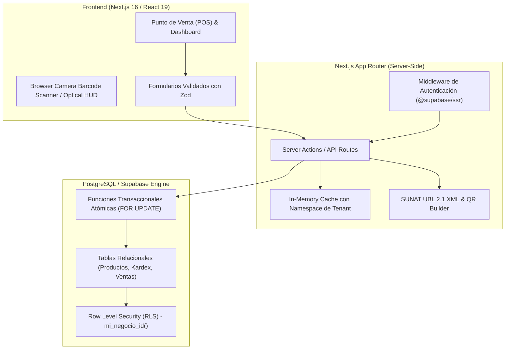

# Stockia · Sistema de Gestión de Almacén e Inventario (WMS)

[](https://github.com/VillanuevaJose/stockia-wms/actions)


**Stockia** es un sistema SaaS multi-tenant para la gestión de almacenes físicos, control de existencias en tiempo real, trazabilidad por Kardex valorizado (método costo promedio ponderado), abastecimiento y punto de venta (POS) para mostrador con facturación electrónica adaptada a la normativa SUNAT (UBL 2.1).

---

## 🏗 Arquitectura del Sistema

El sistema implementa una arquitectura orientada a la consistencia transaccional y el aislamiento estricto de datos entre empresas (tenants):



---

## ⚡ Decisiones Técnicas & Ingeniería de Software

### 1. Control de Concurrencia y Prevención de Stock Negativo
En entornos de ventas rápidas y mostradores concurrentes, las validaciones de stock en el cliente o en el servidor Next.js son vulnerables a condiciones de carrera (*race conditions*).
- **Solución implementada**: Las transacciones de venta, compra y transferencia inter-sedes se ejecutan mediante procedimientos almacenados en PostgreSQL (`registrar_venta`, `registrar_movimiento`) que utilizan bloqueos pesimistas:
  ```sql
  SELECT stock_actual FROM public.inventario
  WHERE producto_id = v_prod_id AND almacen_id = v_alm_id
  FOR UPDATE;
  ```
- **Garantía**: Si dos terminales intentan vender la última unidad al mismo milisegundo, la base de datos serializa las peticiones de forma atómica; la primera descuenta el stock y la segunda lanza una excepción `45000: Stock insuficiente`.

### 2. Aislamiento Multi-Tenant (Seguridad en Capas)
- **Base de Datos**: Políticas activas de Row Level Security (RLS) en todas las tablas sensibles (`productos`, `ventas`, `compras`, `movimientos`, `inventario`). Cada consulta evalúa la función `mi_negocio_id()` basada en `auth.uid()`, impidiendo ataques de Insecure Direct Object References (IDOR).
- **Caché en Memoria**: El servicio de aceleración `withFastCache` estructura sus claves mediante `${tenantId}:${key}`, evitando la contaminación cruzada de datos entre negocios en el mismo proceso de Node.js.

### 3. Facturación Electrónica SUNAT (Estándar UBL 2.1)
El módulo `lib/sunat/ubl-builder.ts` implementa la especificación técnica de SUNAT para comprobantes de pago electrónicos:
- **Desglose tributario**: Cálculo preciso de base imponible y débito fiscal (18% IGV).
- **Firma digital**: Generación del Digest Value usando hashing criptográfico SHA-256 sobre la estructura canónica del XML.
- **Código QR oficial**: Construcción de la cadena delimitada por plecas (`|`) según la Resolución de Superintendencia N° 150-2021/SUNAT.

### 4. Trazabilidad por Kardex y Valorización
Cada movimiento físico (`ENTRADA_COMPRA`, `SALIDA_VENTA`, `AJUSTE_POSITIVO`, `AJUSTE_NEGATIVO`, `TRANSFERENCIA`) queda registrado en el Kardex con su costo unitario histórico y el saldo resultante en unidades y valor monetario.

---

## 🛠 Stack Tecnológico

| Capa | Tecnología | Justificación |
| :--- | :--- | :--- |
| **Framework** | Next.js 16.4 (App Router) | Server Components para rendimiento inicial y Server Actions para mutaciones tipo-seguras sin APIs REST redundantes. |
| **Frontend** | React 19 + Tailwind CSS v4 | Nuevos hooks (`useTransition`, `useActionState`), tipografía del sistema `font-sans` limpia y rendimiento optimizado. |
| **Tipado & Validación** | TypeScript 5 + Zod | Tipado estricto en tiempo de compilación y validación en tiempo de ejecución en formularios y payloads de entrada. |
| **Base de Datos & Auth** | Supabase (PostgreSQL 15) | Autenticación con cookies HttpOnly seguras vía `@supabase/ssr` y lógica transaccional ACID en base de datos. |
| **Testing** | Vitest 2.x | Suite de pruebas unitarias rápida con soporte nativo para TypeScript y aliases de ruta. |
| **CI/CD** | GitHub Actions | Pipeline automatizado que valida linting, comprobación de tipos, tests unitarios y compilación de producción en cada push. |

---

## 🧪 Pruebas Automatizadas & CI/CD

El repositorio cuenta con una suite de pruebas unitarias ejecutadas con **Vitest**:

```bash
# Ejecutar todas las pruebas unitarias
npm test

# Ejecutar con reporte de cobertura
npx vitest run --coverage
```

### Casos de prueba cubiertos:
1. `tests/unit/ubl-builder.test.ts`:
   - Detección de tipo de comprobante (Boleta `03` vs Factura `01`).
   - Cálculo de base imponible y 18% IGV.
   - Generación de Digest Value SHA-256.
   - Formato oficial del código QR SUNAT.
2. `tests/unit/auth-validations.test.ts`:
   - Validación de emails corporativos.
   - Restricciones de complejidad de contraseña (mayúsculas, números, símbolos).
   - Formato de RUC (11 dígitos numéricos).
3. `tests/unit/fast-cache.test.ts`:
   - Aislamiento estricto de claves por tenant.
   - Aciertos y expiración de caché TTL.
   - Invalidación selectiva por prefijo.

---

## 🚀 Instalación y Puesta en Marcha Local

### 1. Clonar el repositorio
```bash
git clone https://github.com/VillanuevaJose/stockia-wms.git
cd stockia-wms
```

### 2. Instalar dependencias
```bash
npm install
```

### 3. Configurar variables de entorno
Copia la plantilla `.env.example` como `.env.local`:
```bash
cp .env.example .env.local
```

Completa las variables de tu proyecto Supabase:
```env
NEXT_PUBLIC_SUPABASE_URL=https://tu-proyecto.supabase.co
NEXT_PUBLIC_SUPABASE_ANON_KEY=tu-anon-key-de-supabase
SUPABASE_SERVICE_ROLE_KEY=tu-service-role-key-de-supabase
```

### 4. Configurar la base de datos
En el SQL Editor de tu proyecto Supabase, ejecuta los scripts de la carpeta `supabase/` en este orden:
1. `supabase/01_schema.sql` (Tablas, llaves primarias UUID, llaves foráneas e índices)
2. `supabase/02_funciones.sql` (Funciones transaccionales y RPCs con `FOR UPDATE`)
3. `supabase/03_rls.sql` (Políticas de Row Level Security por tenant)

### 5. Iniciar la aplicación
```bash
# Desarrollo
npm run dev

# Compilación y producción
npm run build
npm start
```
Abre [http://localhost:3000](http://localhost:3000) en tu navegador.

---

## 👥 Roles de Usuario (RBAC)

| Rol | Alcance Operativo |
| :--- | :--- |
| **Administrador (`admin`)** | Control total: gestión de almacenes/sedes, usuarios y roles, compras, ventas, catálogo, auditoría de turnos y configuración. |
| **Jefe de Almacén (`almacenero`)** | Operaciones de custodia: inventario físico, trazabilidad en Kardex, recepción de compras y catálogo de productos. |
| **Vendedor (`vendedor`)** | Mostrador y POS: punto de venta táctil `/vendedor`, lector óptico de código de barras, arqueo de turno y cobro. |

---

## 📄 Licencia

Este proyecto está bajo la Licencia MIT.
