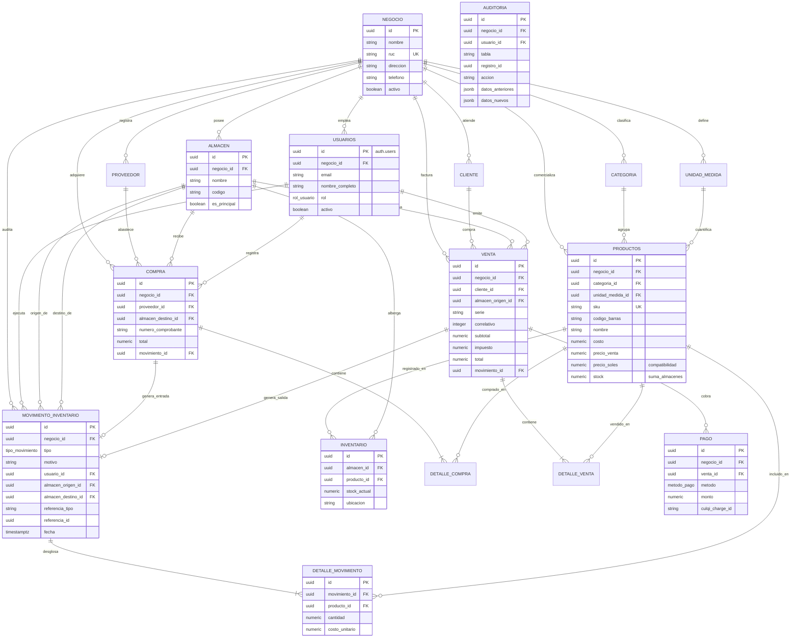

# Arquitectura de Base de Datos - WMS Ligero (Fase 2A)

Este directorio contiene los scripts DDL y DML para transformar el prototipo inicial en un **Sistema de Gestión de Almacén e Inventario (WMS / SGA)** con control de stock multi-almacén, kardex transaccional, trazabilidad de compras y ventas, pasarela de pagos (preparada para Culqi) y seguridad RBAC con RLS.

---

## 1. Orden Estricto de Migraciones (`supabase/migrations/`)

Abre tu proyecto en [Supabase Dashboard](https://supabase.com/dashboard) > **SQL Editor** > **New Query**, o ejecuta las migraciones numeradas en orden:

| Migración | Archivo | Propósito |
| :--- | :--- | :--- |
| **001** | [`001_esquema_inicial.sql`](./migrations/001_esquema_inicial.sql) | DDL maestro: enums, tablas del sistema, llaves foráneas, índices de búsqueda y tabla de auditoría con soporte dual. |
| **002** | [`002_trigger_crear_perfil.sql`](./migrations/002_trigger_crear_perfil.sql) | Trigger transaccional que enlaza automáticamente nuevos registros de `auth.users` con el perfil `public.usuarios`. |
| **003** | [`003_roles_y_permisos_rbac.sql`](./migrations/003_roles_y_permisos_rbac.sql) | Funciones de seguridad RBAC (`mi_negocio_id()`, `mi_rol()`, `es_admin()`). |
| **004** | [`004_politicas_rls.sql`](./migrations/004_politicas_rls.sql) | Políticas Row Level Security para aislamiento multi-tenant y restricción de perfiles de usuario. |
| **005** | [`005_funciones_kardex_movimientos.sql`](./migrations/005_funciones_kardex_movimientos.sql) | Procedimiento `registrar_movimiento` con bloqueo pesimista `FOR UPDATE` e integridad contra mutaciones directas de stock. |
| **006** | [`006_funciones_compras_y_ventas.sql`](./migrations/006_funciones_compras_y_ventas.sql) | Lógica transaccional de compras y punto de venta (POS) con generación de correlativos y pagos. |
| **007** | [`007_auditoria_sistema.sql`](./migrations/007_auditoria_sistema.sql) | Triggers de auditoría automática con captura de deltas JSON en tablas maestras. |
| **008** | [`008_comunicacion_inter_sedes.sql`](./migrations/008_comunicacion_inter_sedes.sql) | Módulo y tabla `solicitud_traslado` para requerimientos y comunicación formal entre sedes físicas. |
| **009** | [`009_asignacion_sedes_usuarios.sql`](./migrations/009_asignacion_sedes_usuarios.sql) | Asignación operativa de colaboradores a sedes físicas (`almacen_id`) por parte del Administrador. |
| **010** | [`010_semillas_y_catalogo_inicial.sql`](./migrations/010_semillas_y_catalogo_inicial.sql) | Semilla base: 1 empresa, 3 sedes físicas (Central, Norte, Sur), categorías y catálogo inicial con stock. |

---

## 2. Generación de Tipos TypeScript (`types/database.ts`)

Los tipos de TypeScript ya fueron generados y tipados estrictamente en [`types/database.ts`](../types/database.ts). 

Si deseas regenerarlos directamente desde la API de Supabase en el futuro una vez ejecutados los scripts SQL:
1. Inicia sesión en la CLI de Supabase con tu token personal:
   ```bash
   npx supabase login
   ```
2. Ejecuta la introspección del proyecto:
   ```bash
   npx supabase gen types typescript --project-id adyqyqjbqzhfhdajvkzz > types/database.ts
   ```

---

## 3. Diagrama Entidad-Relación (Mermaid `erDiagram`)



---

## 4. Garantías de Concurrencia e Integridad del Kardex

1. **Prevención de condiciones de carrera:** Al procesar movimientos de salida o traslados, `registrar_movimiento` aplica `SELECT stock_actual ... FOR UPDATE` sobre la tabla `inventario`. Esto bloquea la fila a nivel de transacción PostgreSQL, evitando que dos ventas o despachos concurrentes sobrevenda stock físico.
2. **Imposibilidad de stock negativo:** Si la cantidad requerida supera el `stock_actual` bloqueado, se lanza una excepción inmediata que revierte (`ROLLBACK`) toda la transacción.
3. **Bloqueo contra edición manual:** El trigger `trg_bloquear_modificacion_directa_stock` rechaza cualquier `UPDATE` directo a la columna `stock_actual` de `inventario` si no proviene de las funciones transaccionales autorizadas.
